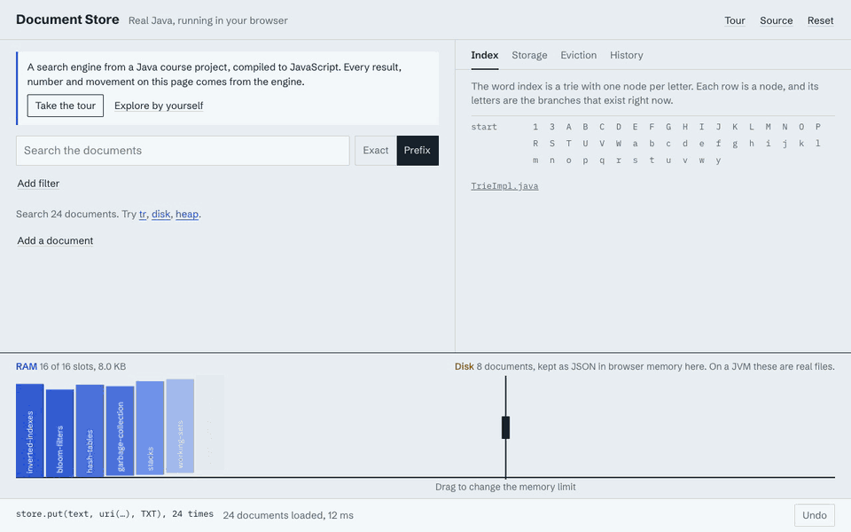

# Document Store & Search Engine

A Java search engine and document database, built on its own Trie, B-Tree, and Min-Heap instead of Java's built-in trees and heaps.

**[Try the live demo](https://relhirs.github.io/doc_store_search_engine/).** The real Stage 6 Java is compiled to JavaScript and runs in your browser, so there's no server. Drag the memory limit and watch documents move from RAM to disk.



## What it does

- Stores text and binary documents, each identified by a URI
- Searches documents by keyword or prefix, ranked by relevance
- Filters search results by custom metadata (tags)
- Supports multi-step undo for every change, including undoing one document's last change on its own
- Automatically moves old, unused documents from memory to disk when limits are hit, and brings them back when they're needed

## How it works

- **Trie** — indexes every word for fast keyword and prefix search
- **B-Tree** — stores documents, with built-in support for paging data to disk
- **Min-Heap** — tracks least-recently-used documents for automatic memory cleanup
- **Stack** — powers the undo history
- **JSON (via Gson)** — saves documents to disk when they're evicted from memory

None of these structures come from Java's standard library. Java's `HashMap` and `HashSet` only handle smaller jobs, like word counts and bookkeeping.

## Built with

Java 17 · Maven · JUnit 5 · Gson

## Testing

Stage 6 has 162 tests. Along with the usual unit tests, they:

- Insert keys into the B-Tree in shuffled orders and check every key after every insert
- Check what's in memory and what's on disk as documents move between the two
- Run random operations and compare the store to a simple model after every step

To run them:

```
cd stage6
mvn test
```

## Project layout

This repo is split into 6 stages, each building on the last. **Stage 6** (`stage6`) is the final, complete version of the project.

See [PROJECT_OVERVIEW.md](PROJECT_OVERVIEW.md) for a deeper technical breakdown.
